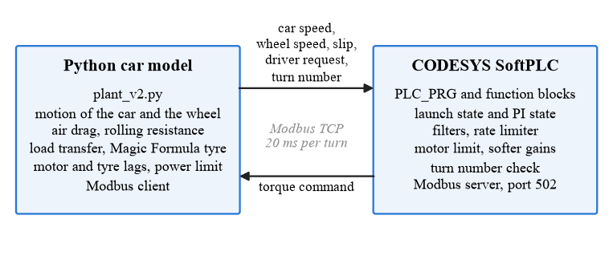
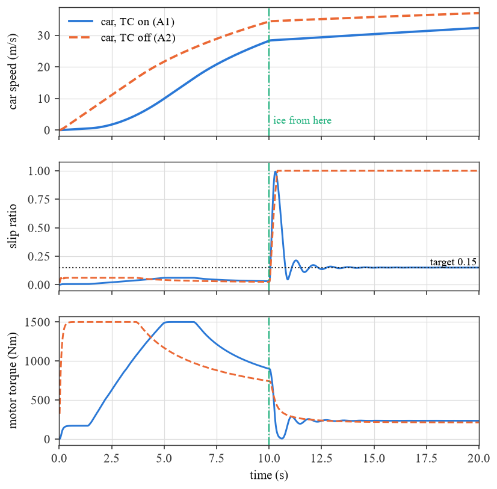
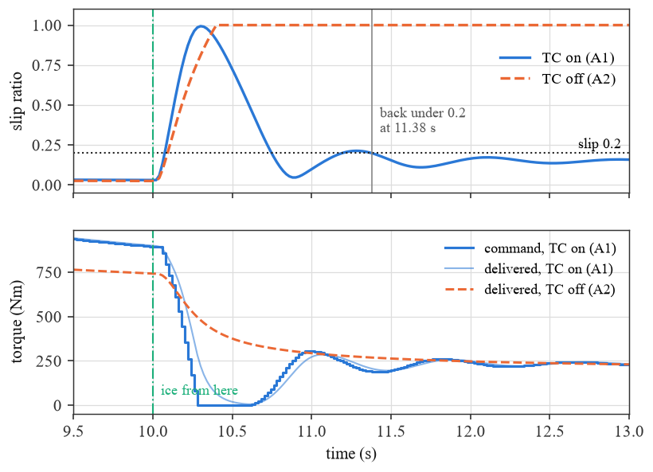
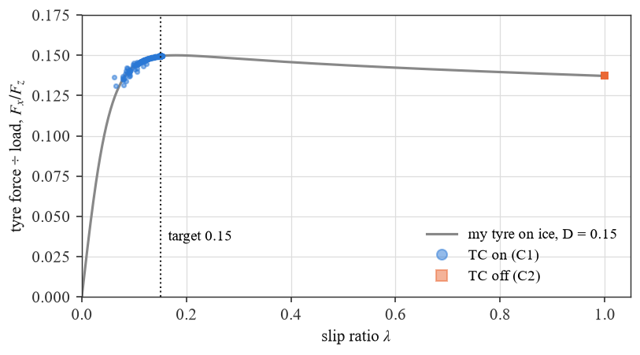
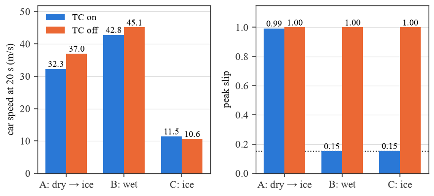

# Traction Control for an Electric Car — Python Plant + CODESYS SoftPLC

The code and result logs of my BSc thesis, *Design and Implementation of a Hardware-in-the-Loop
(HIL) Traction Control System for Electric Vehicles* (University of Debrecen, Electrical
Engineering BSc, 2026). This is the version behind the thesis draft of 29 October 2026.

A Python program simulates the car. A traction controller written in Structured Text runs in a
CODESYS SoftPLC. The two exchange data over Modbus TCP every 20 ms of car time, and the
controller holds the slip of the driven wheel at 0.15.

## Files

| File | What it is |
|---|---|
| `plant_v2.py` | the car model and the Modbus client; writes one CSV row per turn and plots the run |
| `st.txt` | the controller, exported from CODESYS: `PLC_PRG`, `FB_PI`, `FB_LowPassFilter`, `FB_RateLimiter` and two scaling functions |
| `thesis_results.py` | reads the six final logs and writes `thesis_results.csv` |
| `final_A1.csv` … `final_C2.csv` | the six final runs (20 s each, 1000 rows) |
| `figures/` | the graphs below, drawn from the six logs |
| `thesis_results.csv` | speed at 10 s, peak slip, 0–100 km/h and the last time the slip was above 0.2, for each run |

## The car model (`plant_v2.py`)

- Straight-line motion of the car and of one driven wheel; the car gets the force of both rear wheels.
- Air drag, rolling resistance (C_rr 0.015), dynamic load transfer to the rear axle.
- Pacejka Magic Formula tyre, B = 10, C = 1.9, E = 0.97; the road sets D: dry 1.0, wet 0.6, ice 0.15.
- Motor lag 0.08 s, tyre lag 0.035 s, motor power limit 75 kW per driven wheel.
- Explicit Euler, five substeps of 4 ms in every 20 ms turn.
- Values of the VW ID.3 Pro Performance: 1805 kg, 150 kW, wheelbase 2.77 m, C_d 0.267,
  frontal area 2.36 m², tyre 215/55 R18 (radius 0.347 m). Without traction control the model
  reaches 100 km/h in 7.08 s; the real car does it in 7.3 s.

## The controller (`st.txt`)

- PI controller on the slip error (KP 800, KI 3170), with back-calculation anti-windup.
- Launch state below 0.5 m/s: at most 170 Nm, with a bumpless handover to the PI.
- Low-pass filters (α = 0.3) on the slip and the driver request.
- Rate limiter: +35 / −120 Nm per step.
- The motor's power limit inside the controller, so it never asks for torque the motor cannot give.
- Softer gains at low speed, where the slip reacts much more strongly to a change of torque.

## The link

Python is the Modbus client (`pyModbusTCP`), the PLC is the server on port 502.

| Register | Direction | Value |
|---|---|---|
| input 0 | PLC → Python | torque command × 10 |
| holding 1 | Python → PLC | car speed × 100 |
| holding 2 | Python → PLC | wheel speed × 100, with 0.02 m/s noise |
| holding 3 | Python → PLC | slip × 1000, signed |
| holding 4 | Python → PLC | driver request (Nm) |
| holding 5 | Python → PLC | turn number |

The PLC runs its controller only when the turn number changes, so it acts exactly once on every
message. The loop runs in lockstep, not in real time: each turn is exactly 20 ms of car time,
however long it takes on the clock. Both programs run on the same PC.

## Results

The driver asks for 1500 Nm in every run. Run A is dry for 10 s, then ice.

| Run | Road | Traction control | Speed at 10 s (m/s) | Peak slip | 0–100 km/h |
|---|---|---|---|---|---|
| A1 | dry → ice | on | 28.25 | 0.993 | 9.82 s |
| A2 | dry → ice | off | 34.34 | 1.0 | 7.08 s |
| B1 | wet | on | 23.49 | 0.152 | 11.60 s |
| B2 | wet | off | 28.36 | 1.0 | 9.78 s |
| C1 | ice | on | 5.58 | 0.154 | — |
| C2 | ice | off | 5.38 | 1.0 | — |

When the road turns to ice, the controller brings the slip back under 0.2 in 1.38 s; without it
the wheel spins at slip 1.0 to the end. On ice the controller is also faster: 11.46 m/s at 20 s
against 10.64 m/s. On dry and wet the car without it is faster in a straight line, because the
model has no steering and a spinning tyre still keeps most of its grip.

### Run A: dry for 10 s, then ice

Car speed, slip and motor torque, with traction control (A1) and without (A2).

The first three seconds on ice: the controller cuts the torque to zero, lets the wheel slow
down, and brings the slip back. Without it the slip stays at 1.0.

### Where the tyre works on ice

Every row of runs C1 and C2 from 2 s on, placed on the tyre's ice curve. With traction control
the tyre works near the top of the curve; without it, at the far end.

### All six runs

## How to run

1. Python 3 with `pyModbusTCP` and `matplotlib`.
2. In CODESYS, create the program and function blocks from `st.txt`, add a Modbus TCP server
   device on port 502 mapped to the registers above, and set the task cycle to 20 ms.
3. In `plant_v2.py`, set the PLC's address in `ModbusClient(host=...)`, `TC_ON`, and the log
   file name in the `open(...)` line.
4. In CODESYS: Reset warm, then Start (for runs with traction control).
5. Run `python plant_v2.py` and type the road: `dry` (turns to ice at 10 s), `wet` or `ice`.
6. After all six runs, `python thesis_results.py`.

## Author

Abdurakhmon Kuchkorov — [github.com/justkuchkorov](https://github.com/justkuchkorov)

MIT License, see `LICENSE`.
